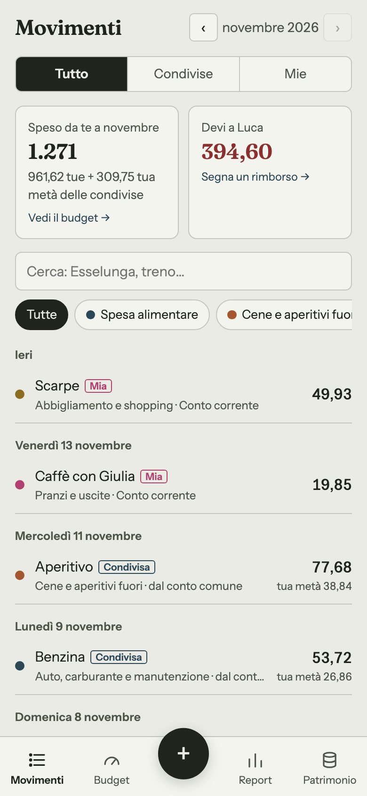
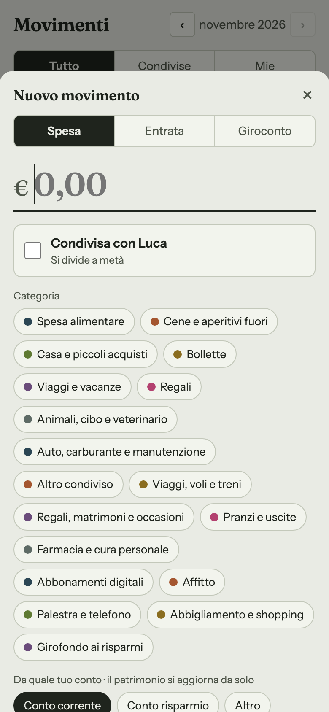
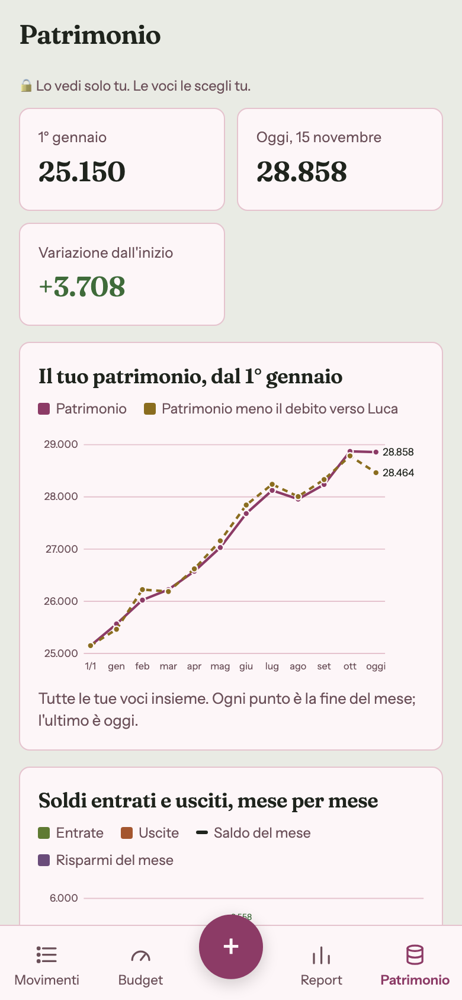

# Halfsies

A mobile-first web app for a two-person household: shared expenses split in half,
a shared budget, and each person's private finances, all in one place.

It runs as a single HTML file, with Google sign-in and a Firestore database, and
deploys for free on Firebase and Vercel.

> The interface is in Italian. This README is in English.

<p>
  
  
  
  
  
</p>

*Screenshots use sample data.*

## What it does

- **Movimenti (transactions)**: every expense and income of the month, by day, with
  filters (all / shared / mine), search and categories. Two cards show what you spent
  this month and how much one person owes the other.
- **+ (add)**: one form for any expense. Tick *Condivisa* ("shared") and it is split in
  half, and the app asks who paid: you, your partner or the joint account. Bills have a
  service period, so they count in the right month. Recurring items are set once.
- **Budget**: two parts. *Insieme* ("together"): joint account balance, shared spending
  against a budget you set together, recurring items and monthly contributions.
  *Il tuo* ("yours", private): monthly plan (income − fixed costs − savings = what you
  can spend) and your own categories.
- **Report**: your spending plus your half of the shared spending, by category and
  month by month, and the biggest expenses.
- **Patrimonio (net worth, private)**: your accounts, savings, investments and debts;
  value on 1 January and today; a monthly chart; money in and out each month.
  Accounts marked as automatic update themselves with the transactions you record.
- **Import from bank statements**: reads a CSV or Excel file in the browser; for each
  row you choose shared, mine or skip. Re-importing the same file does not create
  duplicates.
- **Backup**: download everything you can see as a JSON file, and load it back.

## How it is built

- **One static file**: `index.html` (HTML, CSS and vanilla JavaScript, about 1,950 lines).
  No framework, no build step, no server code.
- **Firebase Authentication** (Google sign-in) and **Cloud Firestore**, with the
  Firebase JS SDK 10.14.1 (compat) loaded from Google's CDN. Real-time listeners keep
  both phones in sync; offline persistence keeps the app usable with a weak connection.
- **Security in the database, not in the UI**: `firestore.rules` lets in only the
  household's Google accounts. Shared data (`shared/**`) is readable by both people;
  private data (`users/<uid>/**`) only by its owner.
- **Vercel** static hosting. `vercel.json` forwards `/__/auth` to Firebase, so Google
  sign-in runs on the site's own domain. Without this, Safari on iPhone blocks the
  login ("missing initial state").
- **SheetJS** 0.18.5 is loaded from cdnjs only when someone imports an Excel file.
- **Safe imports**: imports and backups write rows with stable ids, so loading the
  same file twice does not duplicate anything.

### Files

| File | What it is |
|---|---|
| `index.html` | The whole app |
| `config.js` | Deployment settings: site domain and Firebase web config (empty in this repo) |
| `vercel.json` | Auth forwarding to Firebase and a `noindex` header |
| `firestore.rules` | Firestore security rules (pasted in the Firebase console) |
| `examples/start-file.json` | Start file that creates the household on first login |
| `docs/screenshots/` | Images for this README |

### Data model

The app uses two kinds of paths (see `fsPath()` in `index.html`):

- `shared/casa`: the household document. `members: [{key, name, email}]` and the
  shared `budget: {cats: {category: monthly amount}, by, at}`.
- `shared/casa/<collection>`: shared data. `expenses`, `bills`, `recurring`,
  `deposits`, `depositsRec`, `conguagli` (refunds and opening balances), `passaggi`
  (an expense handed over to the other person). In shared expenses, `chi` is who
  paid (a member `key` or `conto` for the joint account) and `by` is who added it.
- `users/<uid>/<collection>`: private data. `expenses`, `recurring`, `income`,
  `incomeRec`, `giroconti` (transfers between your accounts), `patrimonio`
  (net worth items), `patrimonioStorico` (month-end history) and `impostazioni`
  (personal settings).

## Deploy your own copy

You need a Google account, a GitHub account and a Vercel account. Everything below
fits in the free plans (Firebase Spark, Vercel Hobby). It takes about 30 minutes.

In the steps, `YOUR_PROJECT_ID` is your Firebase project ID and `YOUR_DOMAIN` is the
domain Vercel gives your site (for example `my-halfsies.vercel.app`).

### 1. Get the code

Fork this repository on GitHub, or clone it and push it to a new repository of yours.

### 2. Create the Firebase project

1. Open the [Firebase console](https://console.firebase.google.com) and click
   **Create a project**. Google Analytics is not needed. Note the **project ID**.
2. **Build → Authentication → Get started → Sign-in method → Google → Enable**.
   Choose a support email and save.
3. **Build → Firestore Database → Create database**. Pick a location close to you
   (for example `europe-west8`, Milan; it cannot be changed later) and start in
   **production mode**.

### 3. Set the security rules

1. In `firestore.rules`, replace `you@example.com` and `partner@example.com` with the
   two Google accounts of your household, in lowercase.
2. In the Firebase console: **Firestore Database → Rules**, paste the whole file and
   click **Publish**.

The file in the repository is only a copy: the rules that count are the ones published
in the console. Publish them again every time you change the file.

### 4. Register the web app and fill in `config.js`

1. **Project settings (gear icon) → General → Your apps → Web (`</>`)**. Give it a
   name. You do not need Firebase Hosting.
2. Copy the values of `firebaseConfig` into the `firebase` block of `config.js`.
3. Leave `site` empty for now: you get the domain in the next step.
4. In `vercel.json`, replace `YOUR_PROJECT_ID` with your Firebase project ID
   (in both rewrites).
5. Commit and push.

These values are not secret: every visitor's browser receives them. Access to the
data is controlled by the security rules. GitHub may still flag the `apiKey` as a
"Google API key": for a Firebase web app this is expected.

### 5. Deploy on Vercel

1. In [Vercel](https://vercel.com): **Add New → Project**, then import your repository.
2. Framework preset: **Other**. Leave the build command and output directory empty.
3. Click **Deploy**. Note the domain Vercel gives you: this is `YOUR_DOMAIN`.

### 6. Make Google sign-in work on your domain

1. In `config.js`, set `site` to `YOUR_DOMAIN`, without `https://`
   (for example `site: "my-halfsies.vercel.app"`).
2. In the Firebase console: **Authentication → Settings → Authorized domains →
   Add domain**, and add `YOUR_DOMAIN`.
3. In the [Google Cloud console](https://console.cloud.google.com), with the same project
   selected: **APIs & Services → Credentials → OAuth 2.0 Client IDs → Web client (auto
   created by Google Service)**. Under **Authorized redirect URIs**, add
   `https://YOUR_DOMAIN/__/auth/handler` and save. It can take a few minutes to work.
4. Commit and push. Vercel deploys again by itself.

### 7. First login

1. Copy `examples/start-file.json` and edit it: one entry per person, with a short
   `key` (lowercase, no spaces, for example `anna`), the `name` shown in the app and
   the Google `email`. Use the same emails as in the rules.
2. Open your site and tap **Accedi con Google** ("Sign in with Google").
3. The app says **Manca il file di avvio** ("start file missing"): tap
   **Carica il file di avvio** and choose your edited file. The household is created
   and the app opens.
4. The other person just signs in with their Google account.

Each person can then set their private plan in **Le tue impostazioni** (footer) and add
their accounts in **Patrimonio**.

### 8. Optional: restrict the API key

In the Google Cloud console: **APIs & Services → Credentials → API keys → Browser key
(auto created by Firebase) → Application restrictions → Websites**. Add
`https://YOUR_DOMAIN/*`, `https://YOUR_PROJECT_ID.firebaseapp.com/*` and, for local
testing, `http://localhost:5173/*`.

### Troubleshooting

- **"Il collegamento al database non è configurato"**: `config.js` still has an empty
  `apiKey`.
- **"Account non abilitato"**: the Google account is not in `firestore.rules`, the
  rules were not published, or the account is not among the start file's members.
- **"Non riesco a leggere i dati"**: a network problem; check the connection and reload.
- **"Questo indirizzo non è autorizzato in Firebase"**: add the domain in
  Authentication → Settings → Authorized domains.
- **Login fails on iPhone only**: check `site` in `config.js`, the project ID in
  `vercel.json` and the redirect URI in the Google Cloud console (step 6).

## Run it locally

After step 4, from the project folder:

```bash
python3 -m http.server 5173
```

Then open <http://localhost:5173>. `localhost` is an authorized domain in Firebase by
default, so Google sign-in works against your Firebase project.

## Update the live site

Every push to `main` deploys on Vercel. `.vercelignore` keeps the README, license,
rules, examples and screenshots off the site.

## License

[MIT](LICENSE) © 2026 Annagrazia Stifanelli
