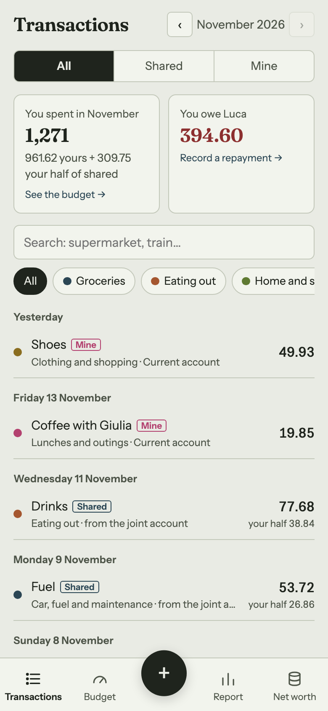
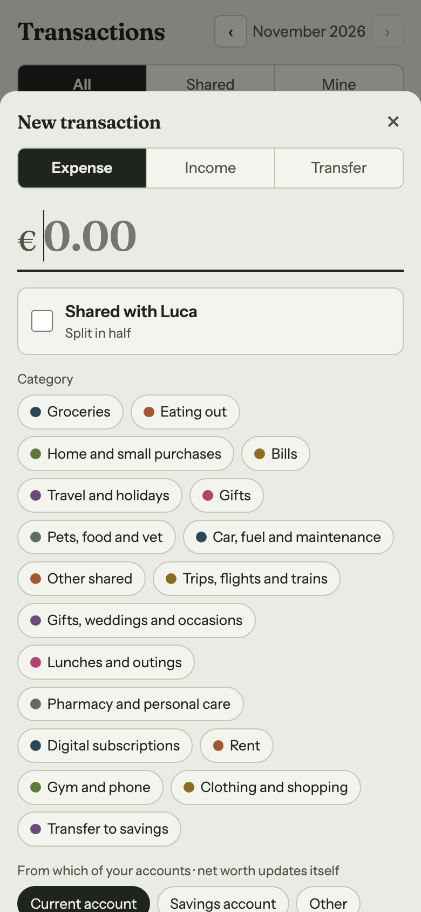
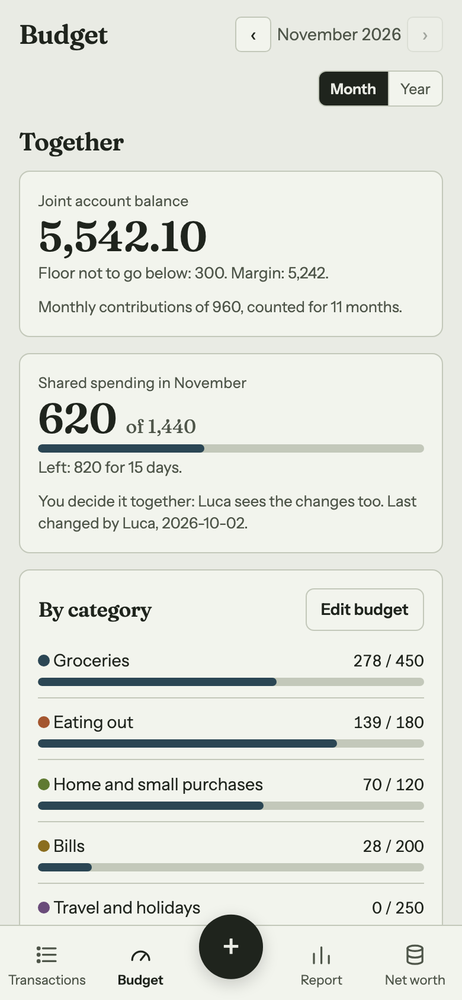
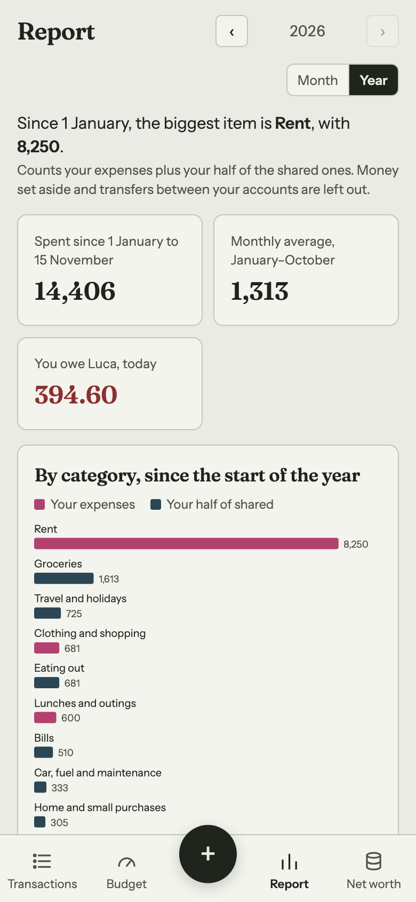
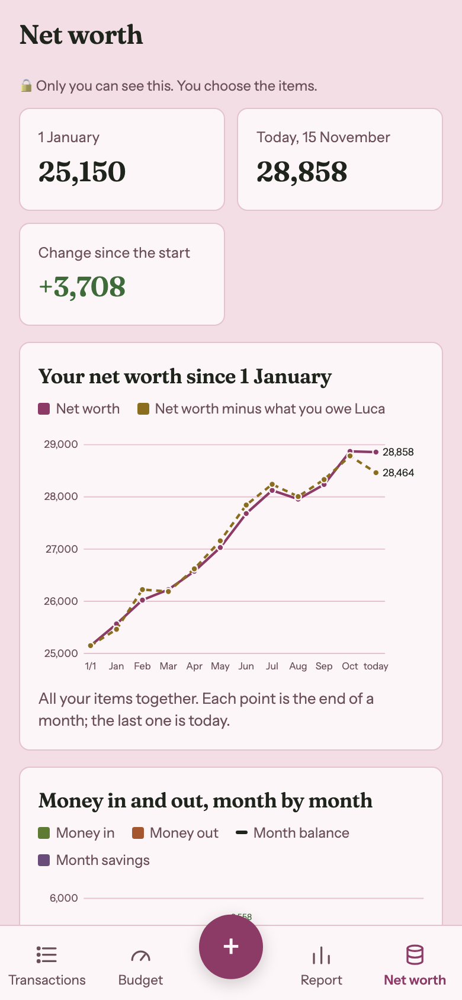

# Halfsies

A budget app for two people who share a home. Shared expenses split in half. Each person also keeps a private budget.

<p>
  
  
  
  
  
</p>

*The screenshots show sample data.*

## Features

- Add an expense and tick "Shared". The app splits it in half and records who paid.
- See how much one person owes the other, and record repayments.
- Set a shared budget and a private monthly plan.
- See a report by category and by month, and a private net worth chart.
- Import transactions from a bank statement (CSV or Excel). The file stays in the browser.

## How it works

- The whole app is one file, `index.html`, in plain JavaScript. There is no build step.
- Firebase Authentication gives Google login. Cloud Firestore stores the data.
- `firestore.rules` lets only the two household accounts read the data. Each person's private data is visible to that person only.
- Vercel hosts the site. `vercel.json` sends `/__/auth` to Firebase, because Safari on iPhone blocks Google login from a different domain.

Code comments are in Italian.

## Deploy your copy

You need a Google account, a GitHub account and a Vercel account. The free plans are enough.

In the steps below, `YOUR_PROJECT_ID` is your Firebase project ID. `YOUR_DOMAIN` is the domain that Vercel gives your site, for example `my-halfsies.vercel.app`.

### 1. Create the Firebase project

1. Fork this repository.
2. In the [Firebase console](https://console.firebase.google.com), create a project. Write down the project ID.
3. Go to **Authentication → Sign-in method**. Enable **Google**.
4. Go to **Firestore Database → Create database**. Choose a location near you and **production mode**. You cannot change the location later.

### 2. Publish the security rules

1. In `firestore.rules`, replace `you@example.com` and `partner@example.com` with the two Google accounts. Use lowercase.
2. In the Firebase console, go to **Firestore Database → Rules**. Paste the file and click **Publish**.

Firebase uses the published rules, not the file. Publish again after each change.

### 3. Fill in the config

1. In the Firebase console, go to **Project settings → General → Your apps**. Add a **Web** app.
2. Copy the `firebaseConfig` values into the `firebase` block of `config.js`.
3. In `vercel.json`, replace `YOUR_PROJECT_ID` in both lines.
4. Commit and push.

The Firebase config is not secret. Every browser receives it. The security rules protect the data.

### 4. Deploy on Vercel

1. In [Vercel](https://vercel.com), click **Add New → Project** and import your fork.
2. Set **Framework Preset** to **Other**. Leave the build settings empty.
3. Click **Deploy**. Write down `YOUR_DOMAIN`.

### 5. Allow Google login on your domain

1. In `config.js`, set `site` to `YOUR_DOMAIN`, without `https://`.
2. In the Firebase console, go to **Authentication → Settings → Authorized domains**. Add `YOUR_DOMAIN`.
3. In the [Google Cloud console](https://console.cloud.google.com), open the same project. Go to **APIs & Services → Credentials** and open **Web client (auto created by Google Service)**. Under **Authorized redirect URIs**, add `https://YOUR_DOMAIN/__/auth/handler`. The change can take a few minutes.
4. Commit and push. Vercel deploys again.

### 6. Create the household

1. Copy `examples/start-file.json`. Write one entry for each person:
   - `key`: a short id in lowercase, for example `anna`
   - `name`: the name that the app shows
   - `email`: the same Google account as in the rules
2. Open your site and click **Sign in with Google**.
3. The app shows **Start file missing**. Click **Upload the start file** and choose your file.
4. The second person opens the site and uses their Google account.

Optional: to limit the API key, go to **APIs & Services → Credentials** in the Google Cloud console. Open the browser key and allow only `https://YOUR_DOMAIN/*` and `https://YOUR_PROJECT_ID.firebaseapp.com/*`.

### If something fails

- **"The database connection is not configured"**: `apiKey` in `config.js` is empty.
- **"Account not allowed"**: the account is not in the published rules or in the start file.
- **"This address is not authorized in Firebase"**: add the domain in **Authorized domains**.
- **Login fails on iPhone only**: check `site` in `config.js`, the project ID in `vercel.json` and the redirect URI from step 5.

## Run it on your computer

After step 3, run this command in the project folder:

```bash
python3 -m http.server 5173
```

Then open <http://localhost:5173>. Firebase allows `localhost` by default.

## License

[MIT](LICENSE) © 2026 Annagrazia Stifanelli
